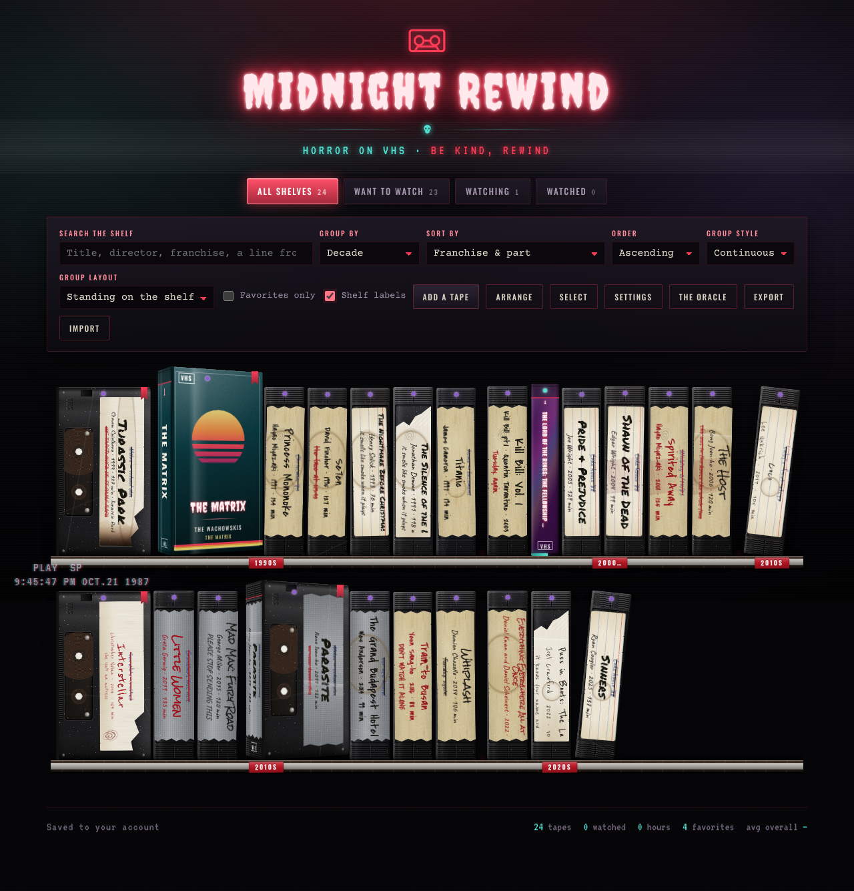

# Midnight Rewind

A movie log that looks like a video store after closing time. Every film is a VHS
tape on a rental shelf, under neon and CRT scanlines; pull one out and it opens
like a clamshell case: the back of the box on the left, the shop's rental card,
with your notes, on the right.

It is the film-side twin of [Gilded Spines](https://github.com/saltandsovereigntypod/guilded-spines),
with every feature that has, reworked for movies and dressed for horror.



## What it does

- **Shelves.** All / Want to Watch / Watching / Paused / Watched / Turned Off,
  with live counts.
- **Tapes, packed onto real shelves.** Every VHS box is the same height, the way
  a rental shelf is, so the variation is in how fat the case is. Lettering is
  sized to the room each spine actually has.
- **Open like a clamshell.** Left: title, director, franchise and part, release
  year, runtime, shelf, date watched, progress through the tape, the plot, and
  ratings. Marking a tape Watched dates it today unless it already has a date.
- **Note sections you name yourself.** The rental card starts with Notes,
  Theories & Twists, Best Kills & Scares and Lines Worth Quoting, and every one
  can be renamed, reordered, deleted or added to, per tape. Settings holds the
  set a new tape starts with; changing it never touches tapes already shelved.
- **Ratings in half steps.** Any number of custom categories (Overall, Scares,
  Gore and Emotional Impact by default), each 0–5 in halves with its own icon:
  stars, skulls, ghosts, blood, knives, bats, pumpkins, popcorn and more. The
  first category shows as pips on the spine.
- **Status lights you control.** An LED in the head band of every spine marks
  its shelf. Settings holds the default and the colour of each status; any tape
  can override both.
- **Per-tape appearance.** Spine and box are painted separately, each from 18
  swatches or any colour, each optionally a gradient with its own angle. Plus the
  staff-pick tag's colour, the status light, lettering size, tape height and
  spine thickness, and your own cover and spine images.
- **Spine and box say different things.** Two checkbox rows decide which of
  title / director / franchise / part number / rating pips appear on the spine
  and which on the box.
- **Tapes that look like tapes.** By default every film is a **bare cassette**,
  out of its box: matte moulded black plastic with gripping ridges, the seam
  between the shell halves, dust, scuffs and worn corners, and a label somebody
  stuck in the well down the spine and wrote on by hand, like a box of home
  recordings found in a basement. The label is masking tape, a ruled stationery
  sticker, duct tape or a half-peeled shop label, with paper fibre and edges and
  ink that wobble the way hand-made things do. Each tape was labelled by one of
  four different hands, in marker (black, red, or pencil). The title is written
  big, across the full width of the spine, down the top of the label; the
  franchise and part, director, year, runtime and your rating as drawn stars run
  below it in small writing.
- **Creepy.** Many tapes are **taped-over home movies**: the old label ("Jenny's
  7th bday", "Grandma's last visit") struck out in ballpoint with the film
  written beside it. Others carry a note from whoever had the tape before ("it
  isn't the movie anymore", "WE TAPED OVER IT. IT CAME BACK", "the face at
  1:13:40"), and some have mug rings, fingerprints, bloody prints and smears,
  water stains, a scorched end or a yellowing strip of Scotch tape. All of it is
  seeded from each tape's id, so a tape looks the same every time; you can pick
  the label and ink yourself, or turn the notes off. Stood front-out, a bare tape
  shows the cassette's face, with the tape on its two reels moving across as you
  watch it.
- **Atmosphere.** A fluorescent tube on the back wall that never quite holds
  steady, its light spilling down behind the shelves; film grain over everything, a fluorescent tube that fails now
  and then, a VCR on-screen display whose clock shows tonight's time in 1987, a
  sign that loses tracking, and tapes that glitch as you reach for them. Settings
  can switch it off; it is always off for reduced motion.
  Or put a tape in a box: **ex-rental** (scuffed, with the shop's barcode
  sticker), **slipcase**, **clamshell**, **foil** or **glossy**, lettered printed,
  eighties **chrome** or **neon**, with generated synth-sun box art.
- **Three ways to stand.** Spine out, front out, or **angled**, in real CSS 3D,
  planted on the shelf with a contact shadow.
- **Or lay a group flat.** Any group can be a **stack** of tapes lying on their
  sides, neat or piled; a messy pile is seeded from each tape's id so it looks
  the same every time.
- **Sort and group.** Sort by franchise & part, title, director, release year,
  date watched, runtime, part number, shelf, favourites, date added, progress,
  any rating category, or your own arrangement. Group by franchise, director,
  **decade**, shelf, rating, favourites or first letter, each group on its own
  shelf or one continuous run.
- **Arrange by hand.** Turn on Arrange and drag tapes, or a whole franchise, into
  the order you want, with a mouse or a fingertip.
- **Style or clear out many tapes at once.** Select, then Apply styling (only the
  rows you tick are written) or Delete selected (type DELETE to confirm). Either
  way one Undo is offered.
- **Search** across titles, directors, franchises, years, the plot and every note.
- **Shelf labels.** Strips of red Dymo embossing tape stuck to the price channel
  under each group. Click one to retype it, or hide it.
- **The Oracle.** A recommender that runs entirely offline over a catalogue of
  194 films in `src/oracle-catalog.json`. The shop is horror-themed; the Oracle is
  not: it offers horror, thrillers, mysteries, crime, sci-fi, fantasy, action,
  comedy, drama, romance and animation. One film at a time, with a predicted
  rating on your own scale, the arithmetic behind it, the genres, what it watches
  like, and an honest note on where it might lose you. **Rent it** puts it on
  Want to Watch; **Not tonight** sets it aside for twenty more draws *and* twenty
  hours; **Wrong read** corrects its tags and the score moves while you watch.
  Sequels wait until you have watched the film they follow.
  **What you want** narrows the draw before it happens: genre (any of several, or
  only the crossovers that are all of them), minimum predicted overall, emotional
  impact, craft and fun, plus scares, gore, darkness, steam, pace, who leads it,
  era, length and standalone or franchise. It shows how many films still fit as
  you set it, and remembers your choices.
  Settings can switch off whole kinds of content (an animal is hurt, sexual
  assault, a child is hurt, suicide or self-harm), and **Recalibrate** re-fits the
  Oracle's weights against films you have rated. Drop the catalogue file and the
  Oracle button simply disappears.
- **Export and import.** Export writes every tape, setting and image to a dated
  JSON file; Import replaces the shelf with one or merges it in.

## The Oracle's numbers

Each catalogue film carries four scored tags, impact, craft and fun (0–5) and
pace (slow burn, steady, fast, relentless), and four that only filter: scares,
gore, darkness and steam. The prediction is

    baseline + Σ (tag ÷ 5 × weight)       (pace uses its own 0–1 scale)

clamped to 0–5. Gilded Spines' weights were fitted to ratings Ash had already
given; nobody had rated any movies yet when this catalogue was built, so the
shipped weights here are an honest starting guess and the card says so. Rate at
least eight films the Oracle knows, as Watched or Turned Off with an Overall
rating, and use **Recalibrate** in Settings. It counts films the Oracle rented
you and any catalogue film you added by hand, matched on title.

The catalogue is written in `tools/catalog_films.py`, which is easier to read and
edit than the JSON; `python3 tools/build_catalog.py` checks it and writes
`src/oracle-catalog.json`. Nothing from the catalogue is ever written onto a tape
except, for films the Oracle rented you, their tags, so a re-fit can use them.

## The two builds

### `artifact/midnight-rewind.html`: the Claude Artifact

The version for claude.ai. It has no `<!doctype>`, `<html>`, `<head>` or `<body>`
because the Artifact runtime supplies those, and it persists through the
Artifact runtime capabilities:

- **`db`**: one document per tape in a `tapes` collection, plus `settings/prefs`
  for rating categories, status lights, default sections, the Oracle's memory,
  shelf label wording and the current sort and grouping.
- **`assets`**: uploaded cover images.

```
capabilities: { db: {}, assets: {} }
```

### `index.html`: the standalone build

Generated by `build.py`: the same app in a full HTML document, with a small
`localStorage` shim standing in for `db`, the tapes in `src/library.seed.json` and the Oracle's catalogue inlined.

**Adding tapes in the code.** A tape written into `src/library.seed.json` reaches
every device the next time the app opens, not only a new one. Each entry is keyed
by its id and carries a `seedRev`; a device applies an entry once per rev, so
later edits or a deletion made in the app stick until the entry's `seedRev` is
raised. An entry lands on the tape with the same id or, failing that, on a tape
already on the shelf with the same title, so a film added by hand is updated
rather than doubled. Its fields replace that tape's, except `ratings`, which merge
category by category. To change a seeded tape everywhere, edit it and bump its
`seedRev`.
Runs from GitHub Pages, any static host, or a plain `file://` open. Images are
downscaled and kept in IndexedDB.

```sh
python3 tools/build_catalog.py   # tools/catalog_films.py -> src/oracle-catalog.json
python3 build.py                 # artifact source + src/*.json -> index.html
```

Edit `artifact/midnight-rewind.html` and re-run the build; never edit `index.html`
by hand.

### The phone app

`build.py` also writes `manifest.webmanifest` and `sw.js`, so the standalone
build installs to a home screen and opens offline; icons are in `icons/`
(`icon.svg` is the source for the PNGs). At 760px wide or less the app switches
to a phone layout: a slim top bar with search, shelf chips, a **View** sheet, and
a tab bar (**Shelf**, **Oracle**, **Add**, **More**). The open tape becomes a page
of its own.

**Publishing.** `.github/workflows/deploy.yml` builds and publishes to GitHub
Pages on every push to `main`. One-time setup: in Settings, Pages, set Source to
*GitHub Actions*. For a custom domain (say `movies.saltandsovereignty.com`), set it
there too, tick Enforce HTTPS, and add a `CNAME` record for `movies` pointing to
`saltandsovereigntypod.github.io` at the domain's DNS host.

## Layout

```
artifact/midnight-rewind.html  the app (single file, no dependencies)
src/library.seed.json          tapes added in the code, merged onto every device
src/oracle-catalog.json        generated: the Oracle's films and shipped weights
tools/catalog_films.py         the Oracle's catalogue, as editable source
tools/build_catalog.py         validates it and writes the JSON
build.py                       wraps the artifact source into index.html
index.html                     generated: standalone build
manifest.webmanifest, sw.js    generated: the installable app and its offline cache
icons/                         app icon (icon.svg) and its PNGs
.github/workflows/deploy.yml   publishes to GitHub Pages
docs/shelf.png                 screenshot
```

## Design notes

One visual world, not a light/dark pair: a video store after midnight. Near-black
with red neon spill, a cyan on-screen-display accent, CRT scanlines over
everything and a tracking band that rolls down the screen now and then. Type is
**Creepster** for the sign, titles and box art, **Oswald** (condensed, like real
VHS spines) for box spines and labels, **Permanent Marker**, **Rock Salt**,
**Reenie Beanie**, **Covered By Your Grace** and **Caveat** for the hand-written
tape labels, **Courier Prime** for body text and the rental
card, and **VT323** for the VCR-style numbers. No frameworks, no build step for
the app itself, no external requests beyond Google Fonts.

The rendering keeps Gilded Spines' governing rule: texture and colour are
independent layers, and a custom colour or gradient touches only the base layer,
so a recoloured ex-rental is still visibly scuffed and a recoloured clamshell
still has its glare stripe. The grain is one `feTurbulence` image per finish,
shared by every tape. Angled tapes are raised by exactly the amount perspective
throws their near corner below the shelf line.

## Data shape

One document per tape:

```json
{
  "title": "The Thing",
  "director": "John Carpenter",
  "series": "",
  "part": null,
  "year": 1982,
  "runtime": 109,
  "status": "watched",
  "watchedOn": "2026-10-21",
  "favorite": true,
  "progress": 100,
  "ratings": { "overall": 5, "scares": 4, "gore": 5 },
  "description": "",
  "sections": [
    { "id": "s1a2b-1x", "label": "Notes", "text": "" }
  ],
  "display": "spine",
  "finish": "bare",
  "lettering": "marker",
  "label": "masking",
  "coverId": null,
  "coverImage": false,
  "spineImage": false,
  "spineColor": "#7A0E1A",
  "spineColor2": null,
  "coverColor": null,
  "ribbonColor": "#FF3B55",
  "spineShow": { "title": true, "director": false, "series": false, "number": true, "pips": true },
  "coverShow": { "title": true, "director": true, "series": true, "number": false, "pips": false },
  "order": 300,
  "addedAt": 1761000000000
}
```

`series` is the franchise and `part` its number. `status` is one of `want`,
`watching`, `paused`, `watched`, `dnf` (Turned Off). Ratings are half steps from
0.5 to 5; an absent key means unrated. `watchedOn` is an ISO date, absent when
unknown.

Appearance fields are optional and fall back to values derived from the title
and franchise. `finish` is `bare`, `rental`, `slipcase`, `clamshell`, `foil` or
`glossy` (default `bare`); `lettering` is `printed`, `chrome` or `neon` and, when absent,
is chrome on foil and printed everywhere else; `sticker` absent means the rental
barcode sticker shows on ex-rentals only. `display` is `spine`, `front` or
`angle`. For a bare tape (`finish` `bare`, the default) `lettering` is `marker`,
`red` or `pencil`; `label` is `masking`, `sticker`, `duct` or `torn`, chosen from
the id when absent; `scrawl` false hides the creepy note. A bare tape ignores the
genre tint the Oracle gives a rented tape, so it stays black plastic. `ribbonColor` is the staff-pick tag a favourite wears. Group layout lives
in the settings record as `groupLayout` and `defaultGroupLayout`.

A tape the Oracle rented you also carries `oracleTags`: the catalogue id and the
eight tags as you had corrected them when you took it.
